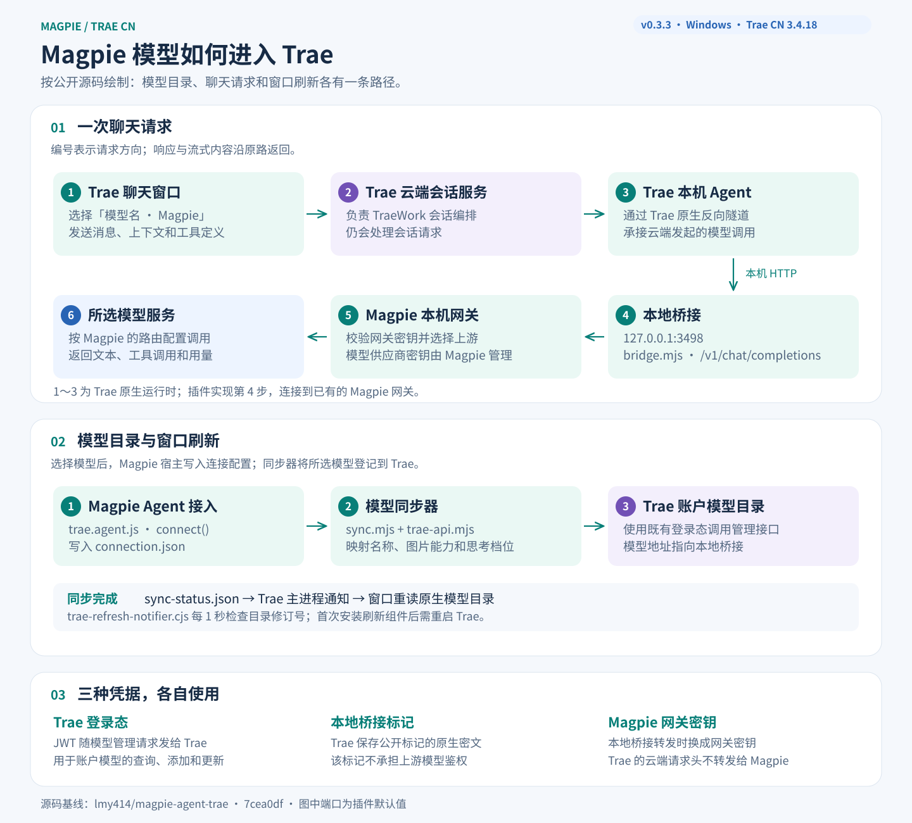

# Magpie Trae Evergreen

[中文](README.md)

Use Magpie models and routing groups from Trae CN's own model picker. This is an unofficial **Agent adapter** for Windows, separate from the community Trae subscription provider.

**What it is:** an adapter that registers Magpie models as Trae custom models and runs a loopback bridge for their requests.

**How it differs from the original:** the upstream adapter authorizes a client by version number plus file SHA-256 allowlists, which breaks whenever Trae ships a new build. This fork authorizes by **credential envelope layout plus a catalog ciphertext self-check**, so the client build number no longer matters.

## Second-development notice

This project is a derivative of [lmy414/magpie-agent-trae](https://github.com/lmy414/magpie-agent-trae) by [@lmy414](https://github.com/lmy414). It reuses that project's Agent contract, catalog synchronization, recovery journal and bridge design. The original implementation is the foundation of almost everything here — **thanks to the original author**.

Upstream is MIT licensed; this project keeps the MIT license and the original copyright notice.

| | Upstream `magpie-agent-trae` | This project `magpie-trae-evergreen` |
| --- | --- | --- |
| Client authorization | Version + DLL/entry SHA-256 allowlist | Layout check + decrypting an existing `ak` from the account catalog |
| After a Trae release | Wait for an allowlist update | Usually nothing to do; fails loudly only on a real scheme change |
| Install discovery | Assumes `%LOCALAPPDATA%\Programs\Trae CN` | Registry → conventional paths → client startup logs |
| Client patch | Matches `out/main.js` against known hashes | Structural check + per-version backup + manifest of the original hash |
| Catalog writes | Back to back | 300 ms apart |
| Runtime namespace | `magpie-trae` / `trae-local` / 3498 | `magpie-trae-evergreen` / `trae-cn-evergreen` / 3499 |
| Coexistence | — | Separate config dir, port, agent ID and rules file |

**Why the namespace is separate:** two adapters sharing `~/.config/magpie-trae/` would overwrite each other's `connection.json` and `sync-status.json`, and worse, `managed-models.json` (the recovery journal) and `client-backups/` (rollback copies). One adapter could delete models the other created, or restore the client from the wrong original file.

## Compatibility

Windows, **Trae CN** only. Trae international, macOS and Linux are not supported.

| Client | Status |
| --- | --- |
| Trae CN 3.4.18 | Verified upstream; same envelope layout here |
| Trae CN 3.4.20 | Verified upstream |
| Trae CN 3.4.22 | Verified here: catalog sync, model add/remove, menu refresh, real chat |
| Other 3.4.x | Works as long as the layout holds; a real scheme change fails with `trae_credential_key_unverified` instead of writing bad credentials |

There is no verified-build list. Authorization requires that the constants extracted from the two native DLLs form a valid AES-256-GCM envelope **and** that this envelope can decrypt an `ak` the account catalog already returned. The second check is cryptographic and independent of the build number.

## Install

Sign in to Trae CN, configure working models in Magpie, then:

```powershell
magpie plugin add "github:CN-P5/magpie-trae-evergreen#new"
```

Or download the source and run `magpie plugin add .` inside the directory.

1. On Magpie's Agents page, enable **Trae CN · Evergreen**. Expand the collapsed agent list if needed.
2. Restart Trae once after the refresh component is first installed or reinstalled after a Trae upgrade.
3. Pick a model ending in `· Magpie` in Trae.

Keep Magpie running and Trae signed in. The adapter never selects a model, focuses a window or edits a prompt.

### Migrating from upstream

The two adapters point models at different loopback ports, so there is no seamless takeover:

1. Turn off the upstream Trae agent in Magpie and wait for `disconnected`; it removes the entries it created and you did not edit.
2. Install this plugin and enable it. Entries are created again on port 3499.

**If a pre-rename install or a different model selection left entries behind**, the account can hold `· Magpie` names pointing at a port nothing listens on. Selecting them fails, and the recovery journal never saw them, so no disconnect removes them:

```powershell
node cli.mjs cleanup           # dry run, lists only
node cli.mjs cleanup --apply   # removes unselected entries whose bridge is silent
```

Cleanup only touches suffixed loopback entries that are neither journaled nor currently selected. Another adapter that is still listening, and every selected model, are left alone.

Do not keep both adapters enabled: Trae's `mcp.json` and rules file are fixed paths that cannot be namespaced.

## Behavior

- Synchronizes catalog additions, capability changes and removals. Model selection stays in Trae.
- Preserves streaming, images, tool calls and reasoning parameters through the loopback bridge.
- Deletes unmodified entries it created when removed or disconnected; restores entries it adopted. Manual edits are preserved and reported.
- Journals writes, verifies the native catalog before confirming success, and recovers from lost responses.
- Uses Magpie's Library contract for selected MCP servers, skills and rules.

Upstream account, quota and capability limits still apply.

## How it works

The adapter registers selected Magpie models as Trae custom models and starts a loopback bridge. TraeWork session orchestration still runs in Trae's cloud; model calls return to the machine through Trae's native tunnel and are handed to Magpie.



`trae.agent.js` implements Magpie's Agent contract: `connect()` returns the gateway URL, gateway key and selected model capabilities. `sync.mjs` maps them to `custom_openai_compatible` entries whose base URL points at the local bridge. `trae-api.mjs` reads the local Trae sign-in and calls the client's internal model APIs; it never writes Trae's SQLite cache.

`trae-local-token.mjs` reads the embedded encryption constants from the installed DLLs and encodes a loopback marker with AES-256-GCM. The extracted profile must decrypt an existing `ak` from the account before it is used. **The AK and even the empty SK must be natively encoded**: plaintext is accepted by model CRUD but rejected by real chat.

`bridge.mjs` listens on `127.0.0.1:3499` by default, accepts only loopback origins, rejects browser `Origin` headers and checks the bridge marker and model ID.

## Client refresh and rollback

For open-window updates the adapter backs up `out/main.js`, appends two lines and installs `out/magpie-model-refresh.cjs`. The component watches a credential-free catalog revision and emits Trae's own model-management notification.

A file whose bytes differ from the recorded backup is refused rather than re-patched. Original files are kept per Trae version under `client-backups/<version>/main.original.js` with a SHA-256 manifest. Set `MAGPIE_TRAE_NO_CLIENT_PATCH=1` to skip the client patch entirely and restart Trae instead.

Disconnect the agent and wait for `disconnected` before uninstalling. Then run `node cli.mjs restore-client` from a source checkout and restart Trae. Backups and journals live under `%USERPROFILE%\.config\magpie-trae-evergreen`; never upload that directory, some files contain credentials.

## Diagnostics

```powershell
node cli.mjs status
node cli.mjs models
```

| Error | Meaning |
| --- | --- |
| `trae_installation_unavailable` | Trae install directory not found; set `TRAE_APP` |
| `trae_credential_profile_unknown` | No valid encryption constants found in the DLLs |
| `trae_credential_key_unverified` | The extracted key cannot decrypt an existing `ak` |
| `trae_sign_in_expired` | Trae session expired; sign in again |
| `trae_client_refresh_build_unsupported` | `out/main.js` differs from its backup; left untouched |
| `duplicate_display_name` (warning) | A same-name `· Magpie` entry already points at another loopback port; no second copy is created. Run `node cli.mjs cleanup` after checking |

**Why duplicates appear at all:** Trae dedupes by `(provider, model_name, base_url)`; the display name is not part of the key. Changing the bridge port therefore looks like a new model, and the server accepts a second identically named entry. This version refuses to create one and reports instead.

## Validation

No npm dependencies. Node.js 20 or newer:

```powershell
npm test
```

`npm run acceptance` needs the installed Magpie and its Bun host; it uses a temporary home and local fixture servers, without touching real accounts.

- 60 unit tests pass on Node 22 and Bun 1.4.4.
- On Trae CN 3.4.22 (installed at `D:\Trae CN`): install discovery, 13-entry catalog read, `ak` decryption, empty-SK encoding and `out/main.js` structural check all pass; 11 models synced and the open-window menu refresh worked, with real use confirmed.
- Upstream 0.3.3 / 0.3.4 validation records (54 / 56 tests, nine isolated integration checks, 3.4.18 and 3.4.20 hardware) remain valid; this fork keeps their sync and retraction logic.

This compatibility update does not address the long-session `3003 / SSE finish` failure. Diagnostics observed a failed continuation after a tool result and HTTP 500 responses from Trae's cloud; the root cause is unconfirmed.

## License

[MIT](LICENSE). See [THIRD_PARTY.md](THIRD_PARTY.md) for the reused community login-state decoder and [ASSET_NOTICE.md](ASSET_NOTICE.md) for the Trae icon. No Trae client binaries are included.

Based on [lmy414/magpie-agent-trae](https://github.com/lmy414/magpie-agent-trae) (MIT). Unofficial; not affiliated with or endorsed by Trae or ByteDance.
